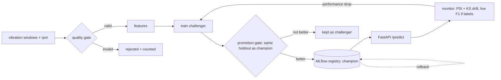

# predmaint: predictive-maintenance MLOps for rotating machinery

Bearing-fault diagnosis for pumps, motors and turbines, built as a full model lifecycle rather than a
notebook: physics-based features, a data-quality gate, drift monitoring, an MLflow registry with a
champion/challenger promotion gate, rollback, and a FastAPI inference service.

Motivation (nuclear context): reactor coolant, feedwater and cooling-water pumps are monitored by
vibration. A diagnostic model there must survive operating-point changes, reject bad sensor data, and
never be replaced by a worse model without evidence.



## The physics

- `bearing.py`: fault frequencies from geometry (BPFO, BPFI, ball defect = 2 x BSF, cage), checked
  against the published CWRU values for the SKF 6205 bearing (unit tests).
- `simulate.py`: a structural resonance excited by fault impacts at those frequencies, with slip
  jitter, the inner-race load-zone modulation, ball-defect cage modulation, random non-fault impacts
  and noise.
- `features.py`: envelope analysis (band-pass, Hilbert, FFT) read **at the fault orders of the measured
  shaft speed**. The same signal processing a vibration analyst does by hand, as features.

## Result: why the physics features matter

Macro-F1 over 5 seeds (mean ± std). Trained on 1500-1800 rpm. Reproduce: `make bench`.

| feature set | in-distribution (1500-1800 rpm) | speed shift (2200-2600 rpm) |
|---|---|---|
| generic_spectrum (time stats + FFT bands) | 0.556 ± 0.028 | 0.583 ± 0.032 |
| generic_envelope (envelope bins in absolute Hz) | 0.971 ± 0.016 | 0.389 ± 0.035 |
| physics_orders (envelope at fault orders) | 0.990 ± 0.005 | 0.985 ± 0.008 |

The generic envelope model looks excellent until the plant changes speed, because it memorised
frequencies in Hz that move with speed. The order-tracked model keeps working because its features
are defined relative to shaft speed. Nothing was tuned between runs.

## Real data: CWRU bearing dataset

`predmaint.cwru` loads the public Case Western Reserve University bearing data (12 kHz drive end, SKF 6205
bearing, the same geometry the physics features use). Data are not bundled: run
`sh scripts/fetch_cwru_mirror.sh` (community GitHub mirror, 40 files, ~135 MB) or download the files from
the CWRU Bearing Data Center. Any folder layout works.

What I checked against the real files before trusting the loader:

- File catalog (which file number is which fault, size, load, position) matches the files in the mirror.
- Normal baselines 97-100 are **48 kHz** while the fault files are 12 kHz. I confirmed this from the data
  (file 97's spectral peaks align with shaft orders only at 48 kHz; files 98-100 match file 97's spectral
  shape at 48 kHz, correlation ~0.65, versus ~0.05 at 12 kHz) and the loader resamples them to 12 kHz.
- The 0.028 inch faults (files 3001-3008) are excluded: documented as a different bearing.
- Physics features respond to the right fault on real signals: envelope SNR at BPFO is 1.41 (log10) for
  outer-race windows vs 0.37 for normal; at BPFI it is 1.68 for inner-race vs 0.36 for normal. The ball
  fault shows only a weak signature (0.66 vs 0.40), consistent with the literature.

Three leakage-safe protocols (windows never overlap across the split):

| protocol | train | test |
|---|---|---|
| temporal | first 70% of every recording | last 30% (same loads and fault sizes) |
| cross_load | 0-1 hp | 2-3 hp |
| cross_severity | 0.007 and 0.014 inch faults | unseen 0.021 inch faults, last 30% of time |

Macro-F1 (ball-fault recall in brackets); CNN is mean ± std over 3 seeds. Reproduce with
`python benchmarks/run_cwru.py --root DIR --protocol P` then `--report`.

| model | temporal | cross_load | cross_severity |
|---|---|---|---|
| HGB + generic spectrum | 0.983 (1.00) | 0.958 (1.00) | 0.542 (0.42) |
| HGB + generic envelope, Hz bins | 0.983 (1.00) | 0.625 (0.97) | 0.649 (1.00) |
| HGB + physics orders | 0.983 (1.00) | **0.996** (1.00) | **0.830** (0.75) |
| 1D-CNN on raw windows (21.8k params) | **1.000 ± 0.000** (1.00) | 0.982 ± 0.018 (1.00) | 0.449 ± 0.023 (1.00) |

How to read this honestly:

- **CWRU is easy.** Under the usual same-conditions split every method scores 98-100%, so that number
  says little. Differences only appear under shift.
- The pattern from the simulator **replicates on real data**: fixed-Hz envelope features break when the
  shaft speed changes (0.625 at cross-load, only a 2-4% speed difference), while order-tracked physics
  features hold (0.996).
- On **unseen fault sizes** the physics model is best (0.83) and the raw-signal CNN is worst (0.45). The
  CNN is an untuned baseline (one architecture, 25 epochs, no hyper-parameter search), so this shows the
  value of domain knowledge in a small-data regime, not that CNNs are weak in general.
- The cross-severity test has only 46 windows from 12 recordings, so expect several points of noise.
  HGB rows have no spread because the model is deterministic; that is not evidence of stability.
- 4 loads of one bearing on one rig. Passing CWRU does not show the model works on a different machine.

Lifecycle on real data (`python examples/cwru_lifecycle.py DIR`): a model trained on 0-1 hp transfers to
2-3 hp with no drift flagged (live macro-F1 0.992), and the promotion gate correctly rejects an equal
retrained model. The pipeline reported "no action needed", which is the right answer here.

## Lifecycle demo (`make demo`)

1. v1 (generic envelope) trained at regime A and promoted: no champion yet.
2. Plant moves to a higher speed. Monitoring flags drift and live macro-F1 drops to 0.38: `retrain`.
3. v2 (physics orders) beats v1 on the regime-B holdout, 0.995 vs 0.378, and is promoted.
4. The same model retrained again does **not** beat the champion by the required margin: rejected.
5. Rollback to v1 and back to v2 by moving an alias.

Monitoring distinguishes cases instead of always alarming: drift with no performance loss gives
`watch`, drift with a performance drop gives `retrain`, and a severe single-feature shift (a sensor gain
error moves RMS by PSI ~8) is flagged even if few features change.

## Quick start

```bash
pip install -e ".[dev]"
make test          # 29 tests (+4 CNN tests when torch is installed, +1 real-data test with CWRU_DIR)
make demo          # full lifecycle, state in ./mlops_state
make ui            # MLflow UI: runs, metrics, registry versions and aliases
make serve         # http://localhost:8001/docs  (needs a champion from `make demo`)
```

CLI: `python -m predmaint.cli --state DIR train --feature-set physics_orders --rpm-min 2200 --rpm-max 2600`,
then `monitor`, `status`, `rollback VERSION`.

## IMPORTANT: limitations

- **The first set of results (feature benchmark and lifecycle demo) uses simulated data.** The simulator is physically motivated but cleaner than real
  machines, and I chose its parameters. Accuracies near 99% are a property of the simulation, not a
  claim about real plants. The meaningful finding is the *relative* behaviour under speed shift.
- CWRU results are in the section above. NASA IMS (run-to-failure) is not supported yet.
- Model files use cloudpickle through MLflow: only load models from a registry you trust.
- Docker image and CI workflow are written but were **not built/run** in my environment. Tests and the
  lifecycle demo were.
- Not used (deliberately small scope): Airflow/Prefect, Evidently, DVC, Kubernetes. Drift is implemented
  directly (PSI + KS, about 40 lines) so it is testable and dependency-free.

## Roadmap

- [x] Real-data run on CWRU with cross-load and cross-severity protocols
- [x] PyTorch 1D-CNN baseline
- [ ] Tune the CNN fairly (or add a spectrogram CNN) before drawing conclusions about deep learning
- [ ] Remaining-useful-life regression on run-to-failure data (NASA IMS)
- [ ] Scheduled retraining (Prefect or cron) and a canary/shadow deployment of challengers
- [ ] Prometheus metrics and a Grafana dashboard for latency, drift share and class mix
- [ ] Physics-informed loss; fault-size (severity) regression
